<h1> Deel 3 - Java </h1>

# Collections

Dingen vergeten uit het eerste jaar:

```java
// Eén property reversen in Comparator (Comparator.reverseOrder())
Collections.sort(reductiebonLijst, Comparator.comparing(Reductiebon::getPercentage)
.thenComparing(Reductiebon::getReductiebonCode, Comparator.reverseOrder()));

// Verwijderen als een bepaalde conditie true is:
lijst.removeIf(element -> element.getter() == value);

// Bewerkingen in streams:
lijst.stream().average();
```

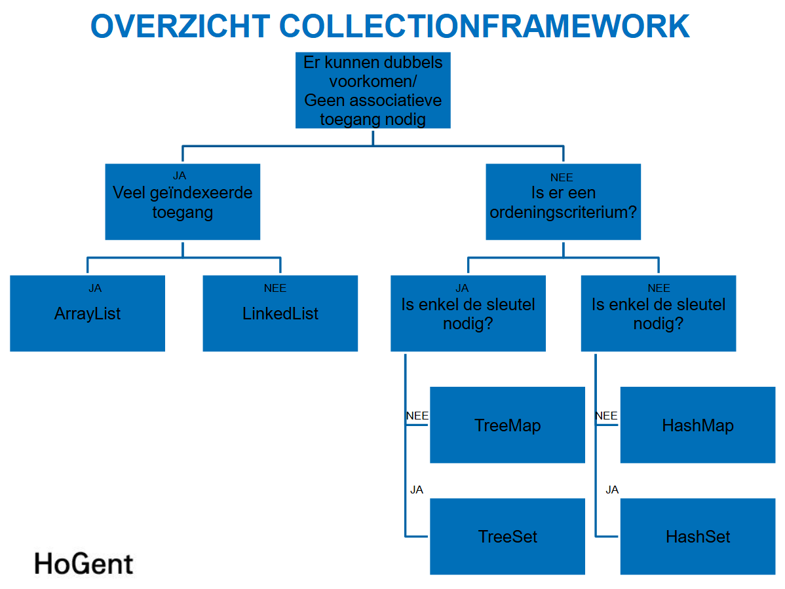

## Maps

`keySet()`, `values()` en `entrySet()` zijn views van de oorspronkelijke Map -> veranderingen in deze sets worden ook in de originele Map doorgevoerd.

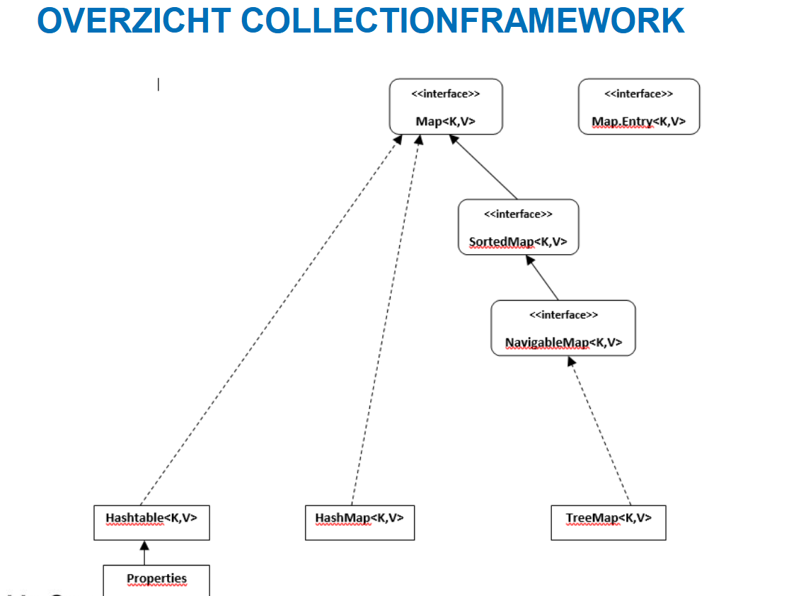

Implementaties:

- HashMap -> elementen opgeslagen in hash-tabel
- HashTable -> verouderde versie van HashMap (NPE als sleutel of value null is)
- TreeMap -> elementen gesorteerd opgeslagen in boomstructuur (gebruikt natuurlijke volgorde of Comparator)

```java
// Van Collection naar Map
Collectors.toMap(key, value);
Collectors.toMap(key, value, (key1, key2) -> key1);
Collectors.toMap(key, value, (key1, key2) -> key1, TreeMap::new);

Collectors.groupingBy(key);
Collectors.groupingBy(key, value);
Collectors.groupingBy(key, TreeMap::new, value);

```

### Map interface

Belangrijkste methoden die ik nog niet veel gebruik:

```java
map.clear();
map.putAll(Map<? extends Key, ? extends Value> m);
map.remove(Object key) // verwijdert de key, returnt ook de value

entry.setValue();
```

### HashMap

Java gebruikt hash buckets om de key-value pairs op te slaan.

- Capaciteit -> aantal buckets dat de HashMap heeft. (wordt verhoogd via `.rehash()`)
- Laadfactor -> Hoe vol de HashMap kan zijn voor de capaciteit verhoogd wordt. (default = 0.75 = 75%)

Een lege constructor zet de capacity op 16 en load factor op 0.75. Je kan ook een Map meegeven aan de constructor om een kopie van een andere Map te maken.

## Synchronisatie

De klassen in het Collection framework zijn unsynchronized. Je kan wrapperklassen gebruiken om ze om te zetten tot synchronized versies -> deze zijn thread-safe.

vb. `Collections.synchronizedList(existingList);`

## Unmodifiable

Je kan de klassen ook wrappen met een Unmodifiable wrapper klasse -> ze throwen dan UnsupportedOperationExceptions als je de lijst probeert aan te passen.

vb. `Collections.unmodifiableList(existingList);`

## Abstract collections

Dienen als abstracte implementaties van de interfaces die als basis voor een zelfgemaakte collection implementatie kunnen dienen.

vb. AbstractCollection, AbstractList, AbstractMap, AbstractSequentialList, AbstractSet

# Generics

De types bij generics => type parameters

Type parameters kunnen geen primitieve datatypes zijn.

Syntax bij methoden:

```java
            // upperbound       return type
public <T extends Comparable<T>> T maximum(T x, T y, T z) {
    return null;
}

// Normale methoden mogen generieke methoden overloaden
public static <T> void printArray(T[] inputArray) {};
public static void printArray(String[] inputArray) {};
```

Nieuwe objecten genereren => Kan niet via type parameter (= Type Erasure principe). Je moet Objects aanmaken, casten naar type parameter en de unchecked warnings suppressen met `@SuppressWarnings("unchecked")`

Type Erasure default naar een Object. Als je ten minste één upperbound meegeeft wordt de eerste upperbound gebruikt i.p.v. Object.

Syntax meerdere upperbounds: `class MultipleBound<T extends A & B>`

- Upperbound: <T extends UpperBound> => T moet UpperBound of een subtype van UpperBound zijn.
- Lowerbound: <T super LowerBound> => T moet LowerBound of een supertype van LowerBound zijn.

# JPA

JPA = Java Persistence API

Configuratie gaat in persistence.xml => de configuratie hierin = persistence unit.

Een peristence unit bevat:

- Een naam
- JDBC url voor de databank
- Type schema generatie (create, drop-and-create, none)
- Opsomming van entities

## Belangrijke klassen

### Vergelijking met Hibernate

| Naam in Hibernate | Naam in JPA          |
| ----------------- | -------------------- |
| Session           | Entity Manager       |
| SessionFactory    | EntityManagerFactory |
| Transaction       | Transaction          |

### Entity Manager

=> Beheert entiteiten, ondersteunt CRUD-operaties, voert JPQL-queries uit.

Wordt aangemaakt door `EntityManagerFactory.createEntityManager("unitName")` te callen => EntityManagerFactory instance is thread safe. <br> unitName = naam van de persistence unit

Entitiy Manager Factory kost veel tijd om aan te maken => best via Singleton.

### Entity

Java Object met bijbehorend record in db.

Entity class = de klasse in Java die de entity beschrijf

- public of protected no-args constructor
- geen final class
- geen nested class
- best Serializable (voor sessiebeheer en netwerkcommunicatie)

## Persistence context

= Verzameling van entiteiten die gekend zijn bij een entity manager.

Als entiteiten binnen de context gewijzigd worden, wordt dit automatisch doorgegeven aan de databank via een transactie.

- Managed entities = bekend binnen de context
- Detached entities = behoren niet tot de context

## Annotations

Standaardannotaties die ik al gebruik niet opgenomen, maar wel te kennen (Entity, Table, Id, Column, etc.)

```java
@Transient // bij private variable die niet moet opgeslagen worden in de database.

```

`@Enumerated(EnumType.Ordinal)` => niet gebruiken, want volgorde zou in de toekomst kunnen wijzigen.

Annotations kunnen voor getters en setters geplaatst worden => JPA gebruikt dan deze methods i.p.v. een variabele

## Relaties

Bij bidirectionele relaties:

- owning side
- inverse side => geef owning side aan met mappedBy

Enkel de wijzigingen aan de owning side worden doorgegeven aan de databank.

Zonder mappedBy krijg je twee relaties.

Als de relatie met meerdere entities kan zijn (one to many, many to many) gebruikt JPA standaard lazy loading. Twee opties om eager loading te gebruiken:

- `@OneToMany(fetch = FetchType.EAGER)` => in entity class
- `Select w from Werknemer w join fetch w.projecten` => in query

Volgorde van een List gaat verloren => behouden via `@OrderBy("attribuut ASC")` <br>
Default volgorde = primary key ascending

### One to One

Kan unidirectioneel (enkel `@OneToOne` gebruiken in entity die een referentie nodig heeft) of bidirectioneel (`@OneToOne` in beide entity classes). Bij een bidirectionele associatie kan je `@OneToOne(mappedBy="kolom")` gebruiken, waar kolom de naam van de variabele is in de andere entity class.

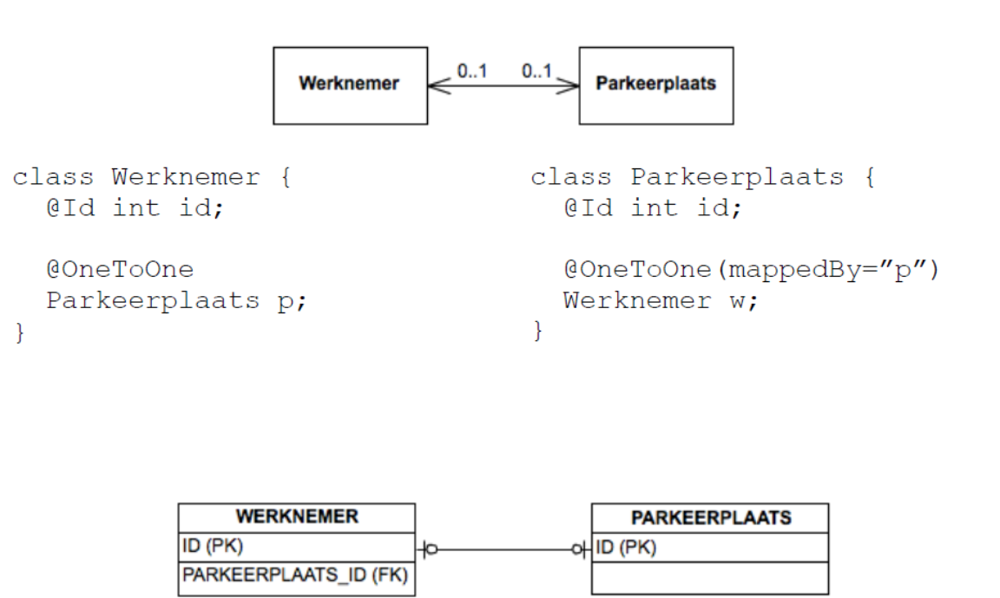

### One to Many / Many to One

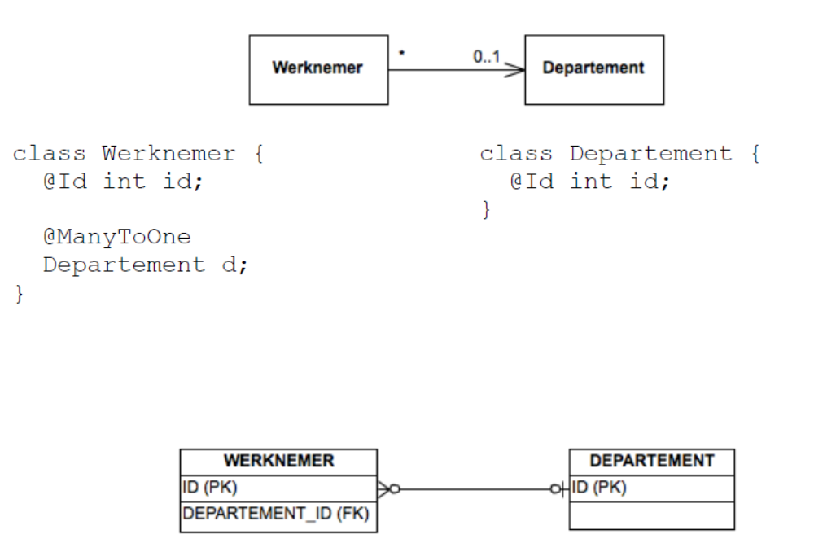

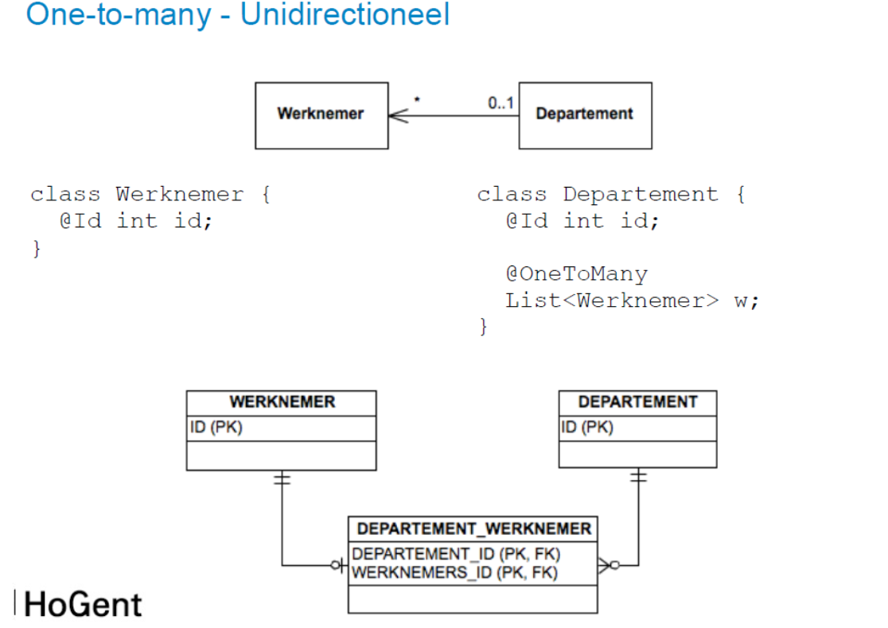

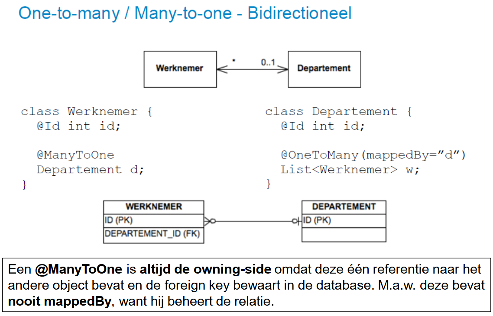

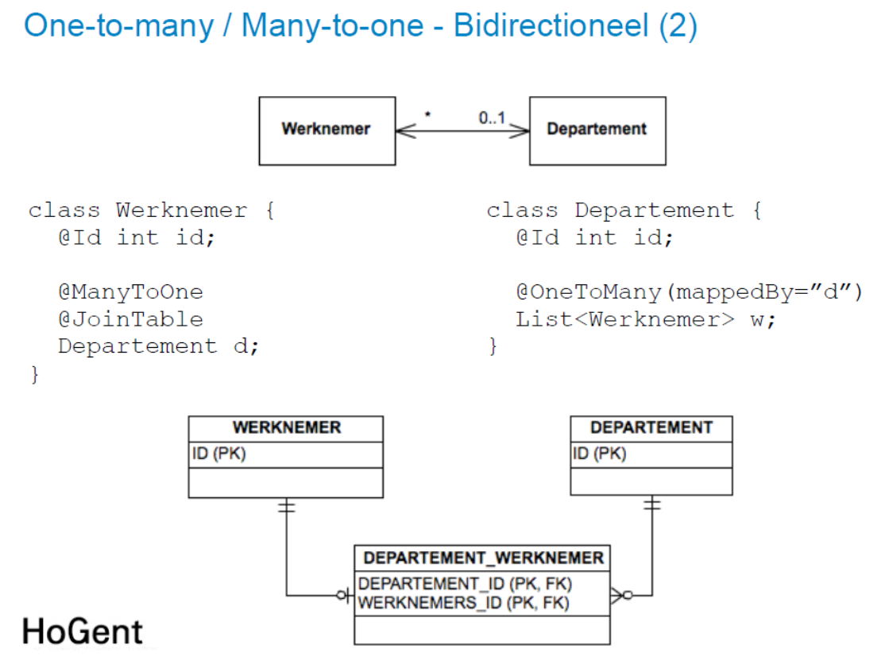

### Many to Many

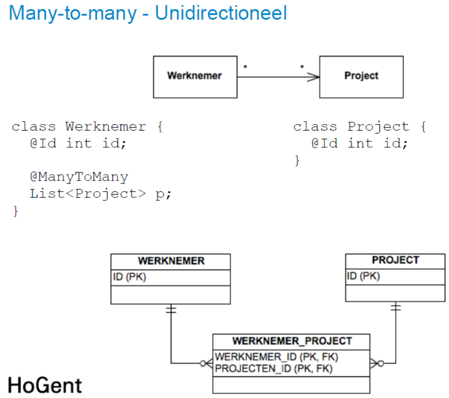
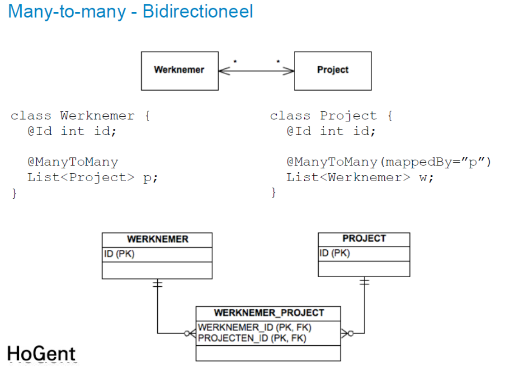

## Overerving

Hoogste entiteitsklasse kiest hoe de overerving geïmplementeerd wordt.

Elke entiteitsklasse gebruikt dezelfde primary key (kan via overerving bijgehouden worden)

=> Als een entiteitklasse overerft van een niet-entiteitklasse, worden de overgeërfde attributen niet gepersisteerd. <br>
(Uitzondering = `@MappedSuperclass` => gedraagt zich als embeddable)

### Tabel per concrete klasse

Geschikt wanneer de subklassen sterk verschillen.

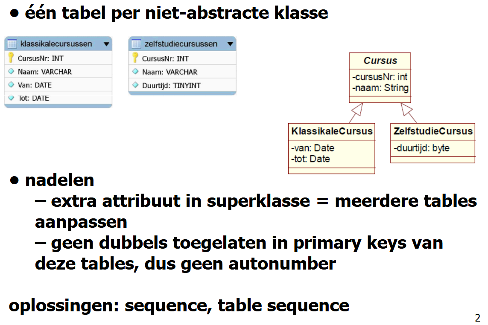

```java
@Inheritance(strategy = InheritanceType.TABLE_PER_CLASS) // definitie op hoogste entiteitsklasse

// Ervoor zorgen dat de IDs uniek blijven => in hoogste entiteitsklasse
@Id
@GeneratedValue(strategy = GenerationType.TABLE, generator = "SeqName")
@TableGenerator(name = "SeqName", table = "TableName", pkColumnName = "NaamNummering", valueColumnName = "hoogsteNummer", pkColumnValue="idColumn")
@Column(name="idColumn")
private int id;ø

```

### Tabel voor volledige hiërarchie

Geschikt wanneer er weinig specifieke velden per subklasse zijn.

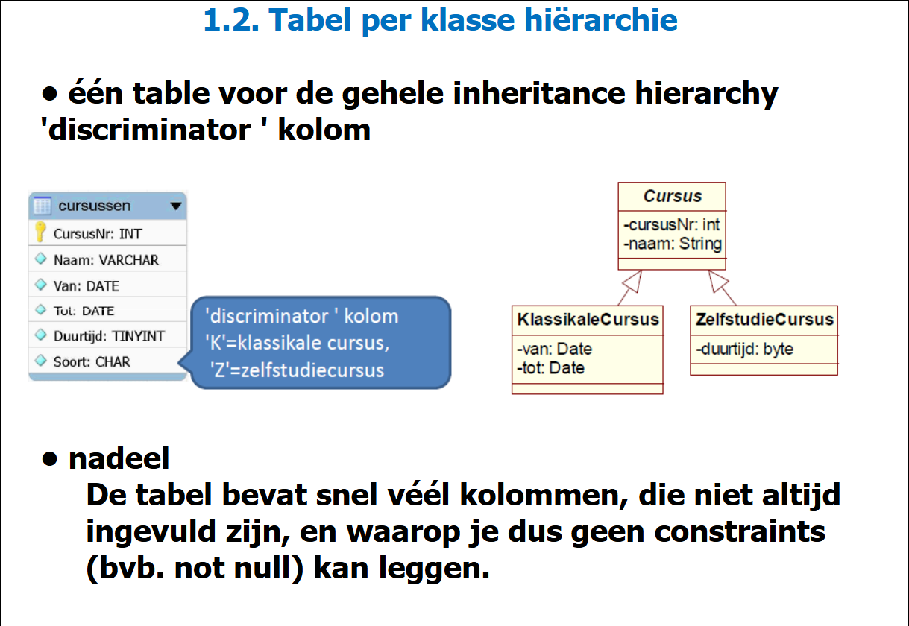

```java
@Inheritance(strategy = InheritanceType.SINGLE_TABLE) // definitie op hoogste entiteitsklasse

@DiscriminatorValue("V") // op subklasse => associeert de subklasse met deze waarde in de discriminator
```

### Tabel per subklasse

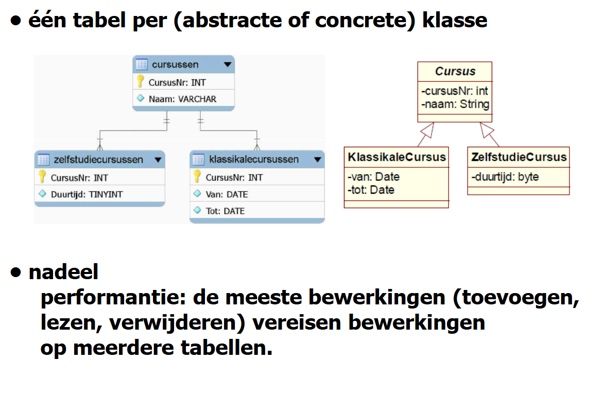

```java
@Inheritance(strategy = InheritanceType.JOINED) // definitie op hoogste entiteitsklasse
```

## Bewerkingen

| Naam    | Functie                                                                                                                                                      |
| ------- | ------------------------------------------------------------------------------------------------------------------------------------------------------------ |
| Find    | returnt entity uit databank of null als er geen resultaat was => gevonden object komt in context                                                             |
| Persist | voegt nieuwe entiteit toe aan context                                                                                                                        |
| Merge   | voegt bestaande entiteit opnieuw toe aan context                                                                                                             |
| Remove  | verwijdert entiteit uit context en databank                                                                                                                  |
| Detach  | haalt de entiteit uit de context, verdere wijzigingen worden niet doorgevoerd => wordt vanzelf uitgevoerd op alle entiteiten in de context na een transactie |

Cascade zorgt ervoor dat bewerkingen ook worden uitgevoerd op andere entiteiten.

Orphan removal => het kind in de relatie wordt automatisch verwijderd als de relatie verbroken wordt

## JPQL

Joins => je hoeft de kolom niet aan te geven (JPA weet al waarop je moet joinen)

```java
"SELECT new EmployeeInfo(e.name, e.salary) FROM Employee e WHERE SIZE(e.projects) > 5" // maakt nieuw EmployeeInfo object aan

"SELECT a FROM auto a WHERE a.onderhoudsbeurten IS NOT EMPTY" // => kijken of een many-relatie associaties heeft
```

Je kan een date aangeven met `{d'yyyy-mm-dd'}`

Om te checken of een variabele deel is van een collectie: `SELECT e FROM Entity e WHERE :element MEMBER OF e.list`

Resultaten terugkrijgen:

- getSingleResult() => geeft result of foutmelding
- getResultList() => geeft een List
- getResultStream() => geeft een Stream

### Named queries

=> worden bij entiteitsklasse geplaatst

Wordt voorgecompileerd en is daardoor sneller.

Definiëren:

```java
@NamedQuery(name="NaamVanDeNamedQuery", query="SELECT e FROM Entity e")
```

Aanroepen met `createNamedQuery("NaamVanDeNamedQuery")`
